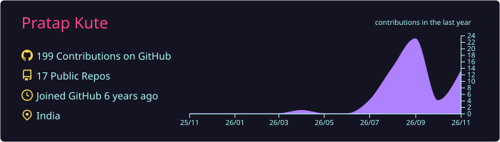
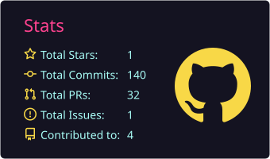
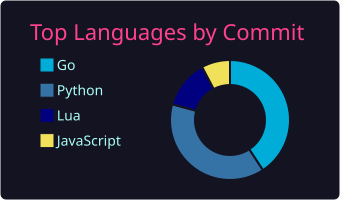

# Pratap Kute

**Software Engineer | DevOps & Automation | Go • Python • Linux**

I build developer tooling, automate Linux environments, and work on backend & full-stack systems in Go, Python, and TypeScript.

---

### Tech Stack

---

### Featured Work

- **[lazyvim-ubuntu-setup](https://github.com/Pratap-kute/lazyvim-ubuntu-setup)** — Automated Ubuntu & Pop!_OS installer (`install_lazyvim.sh`), custom Lua configuration (`nvim_config/` with automatic Python `.venv` detection for LSP & Neotest), Docker test setup, and GitHub Actions CI.
- **[paisa](https://github.com/Pratap-kute/paisa)** *(Customized fork — 90+ commits ahead of upstream)* — Self-hosted personal finance manager for Ledger, hledger, and Beancount (Go backend + Svelte frontend). Extended with a full Svelte 5 runes migration, Indian capital gains tax engine (FIFO grandfathering & FY2024 rules), asset cash breakdown, and hardened CI workflows.

---

### Activity & DevCard

  

  
  

  

